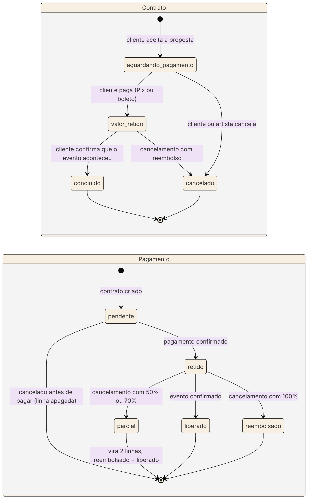

# Diagrama de estados do contrato e do pagamento

O fonte do diagrama está em `diagrama-estados-contrato.mmd` (Mermaid).

## O que o diagrama mostra

O diagrama de sequência da Sprint 7 mostra a **ordem das mensagens** numa contratação. Este mostra outra coisa: **em que situações cada contrato e cada pagamento podem estar, e o que faz um passar para o outro**. É o mapa usado para conferir que nenhuma tela deixa o banco num estado impossível, como um contrato "concluído" com pagamento "pendente".

## Estados do contrato

| Estado | Significado | Sai dele quando |
|---|---|---|
| aguardando_pagamento | Proposta aceita, falta pagar | O cliente paga ou alguém cancela |
| valor_retido | Pago, dinheiro guardado pela plataforma | O cliente confirma o evento ou alguém cancela |
| concluido | Evento confirmado | Estado final: libera a avaliação |
| cancelado | Cancelado pelo cliente ou pelo artista | Estado final: gera um registro em `cancelamentos` |

## Estados do pagamento

| Estado | Significado |
|---|---|
| pendente | Criado junto com o contrato, ainda não pago |
| retido | Pago e guardado até o evento |
| liberado | Repassado ao artista |
| reembolsado | Devolvido ao cliente |

"Parcial" não é um estado gravado no banco. Ele representa o momento em que um cancelamento com 50% ou 70% divide o pagamento em **duas linhas**: uma `reembolsado`, com a parte do cliente, e outra `liberado`, com a parte do artista.

## Combinações válidas

| Contrato | Pagamento(s) |
|---|---|
| aguardando_pagamento | pendente |
| valor_retido | retido |
| concluido | liberado |
| cancelado antes de pagar | nenhum (a linha pendente é apagada) |
| cancelado depois de pagar | reembolsado, liberado ou os dois |

## Regras que o diagrama deixa claras

- **Não existe volta:** um contrato concluído ou cancelado nunca muda de estado de novo.
- **Só dá para avaliar contrato concluído.** Só dá para pagar contrato aguardando pagamento e com data futura.
- **Só dá para cancelar** contratos `aguardando_pagamento` ou `valor_retido` com data de hoje em diante.
- **O cupom de desconto (Sprint 8) entra na passagem `pendente → retido`:** o valor retido já vem com o desconto aplicado.

## Onde cada transição está no código

| Transição | Função em `views.py` |
|---|---|
| criar contrato e pagamento pendente | `aceitar_proposta` |
| pendente → retido | `pagar_contrato` |
| retido → liberado e contrato → concluido | `confirmar_evento` |
| qualquer → cancelado | `cancelar` |
